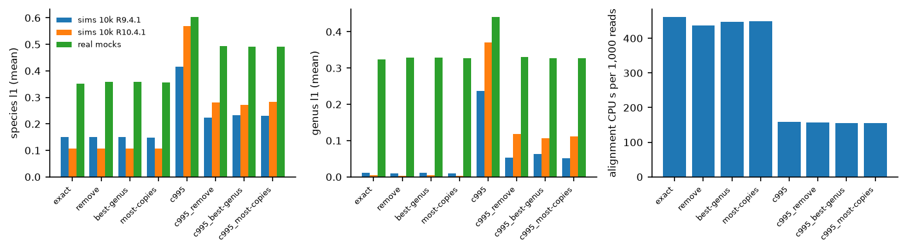

# Cross-genus identical sequences in the database (Phase 13, F56, November 2026)

GTDB r226's SSU set has 1,360 distinct 16S sequences that occur under more than one
genus (1,288 of them under more than one family). They are carried by 4,147 entries of
2,080 species in the exact database, and most look like contaminant contigs in some
assembly (D23). This benchmark asks whether removing them, or keeping each one in a
single genus, improves the estimates. No default changed in this phase; the decision
(D38) is taken on the evidence below.

Every table cited here is in `docs/benchmarks/data/` and the figure in
`docs/benchmarks/figures/`, with its source data under the same name in `data/`. Data,
databases, alignments and per-sample outputs are under
`~/pipelines/NanoVI_benchmarks/phase13` (D11) and are not in the repository.

## 1. The rules

`build_gtdb_db.py --cross-genus-rule` and `main.py build-database --cross-genus-rule`
(NanoVI branch `roadmap/p13-cross-genus-db`, commit `310a8b9`; default `keep`) apply
one rule to the sequences listed in `cross_genus_identical.tsv`. Genera are compared
with GTDB suffixes stripped.

| Rule | What it does |
|---|---|
| `keep` | Nothing (the database as before). |
| `remove` (a) | Removes every copy. |
| `best-genus` (b) | Keeps the sequence only under the genus with the most entries carrying it; a tie removes every copy. |
| `most-copies` (c) | As (b), but a genus scores by the number of input records the sequence had (identical copies before deduplication), entries breaking a tie; a tie on both removes every copy. |

(c) is the third rule the prompt allowed: under (b), 1,117 of the 1,360 sequences tie
(most carry one entry per genus) and are removed everywhere, so (b) is close to (a).
Counting input copies breaks all but 4 ties.

Each build writes `cross_genus_removed.tsv` (every removed entry, the rule and the
genus it was kept in) and `cross_genus_emptied.tsv` (species left with no sequence),
and rebuilds `identical_16s.tsv` from the cleaned sequences.

## 2. How it ran

- **Code.** NanoVI `bin/` at `310a8b9` for every build and run (`NANOVI_REPO` pointed
  at `phase13/br_src`, a `git archive` of that commit). NanoVI-paper scripts at
  `fe85534` (branch `roadmap/p13-cross-genus-db`); `analyse.py cross` gained the real
  reproduction rows and the per-species table in `b5c53d6`.
- **Tools.** The pipeline's tools since Phase 7b: fastplong 0.7.0
  (`quay.io/biocontainers/fastplong:0.7.0--h43da1c4_0`), minimap2 2.31 with samtools
  1.24 (the mulled image `mulled-v2-66534bcb…:ad4c2404…-0`), `-ax map-ont -N 3 -p 0.9
  -K 500M -k 21`, Emu's read score, VB at the defaults. c995 builds: vsearch 2.32.0
  `--cluster_fast --id 0.995` within each species, as Phase 7a built c995. Python
  3.11.17, numpy 2.4.6, pandas 3.0.6, pysam 0.24.1.
- **Exact arm.** Where Phase 7b's pipeline run (`phase7b/confirm/merged/out`) has the
  sample (the 13 real mocks and the 80 simulations at 1k and 10k), its filtered reads
  are used for every database and its alignment for exact, so the exact arm is that
  run. The 50k samples were filtered and aligned here.
- **Host.** A shared 80-core host at load 70-117 from other users, capped at 16 cores
  (D20): 4 workers x 4 minimap2 threads.

Commands (from `benchmarks/`, with `NANOVI_REPO=~/pipelines/NanoVI_benchmarks/phase13/br_src`):

```bash
phase13/db/build.sh                         # 8 builds: {merged, suffix-kept} x {keep, remove, best-genus, most-copies}
phase13/db/build_c995.sh                    # c995 of each cleaned merged build
python db_builds.py --cross                 # db_builds_r226_cross.tsv
python db_audit.py --cross-genus            # cross_genus_rules.tsv, cross_genus_truth_species.tsv
python run_grid.py --design reproduce       # Phase 7a's stored alignments with today's bin/
python real.py --cross --workers 4 --align-threads 4
python run_grid.py --design cross --samples <80 samples at 1k and 10k> --workers 4 --align-threads 4
python run_grid.py --design cross --samples <12 samples at 50k, seeds 1-3> --workers 4 --align-threads 4
python clade_exclusion.py --database <exact|remove|best-genus|most-copies> --seeds 1 --threads 16
python analyse.py cross
```

Runs: real mocks and 1k/10k simulations 2026-10-31 to 2026-11-01; 50k 2026-11-02 to
2026-11-03; clade exclusion 2026-11-03.

Scope (agreed 2026-11-02): all eight databases (exact, the three rules, c995 and c995
of each rule) on the 13 real sup mocks and on the 92 simulations of Phase 7a's one-factor
set (both chemistries, even and log shapes, 1k and 10k seeds 1-10, 50k seeds 1-3).
Clade exclusion (20 species, even 10k seed 1, R9.4.1 and R10.4.1: 40 runs per
database) only for exact and the three rules on it, because every c995 build loses to
exact on 79-80 of 80 simulations at 1k and 10k.

## 3. The builds

`cross_genus_rules.tsv`, `db_builds_r226_cross.tsv` (GTDB r226, 81,173 species in the
taxonomy of the merged build):

| Build (merged) | Entries | Entries removed | Species touched | Species emptied | identical_16s species / groups |
|---|---|---|---|---|---|
| keep (exact) | 232,447 | 0 | 0 | 0 | 4,335 / 1,264 |
| remove | 228,300 | 4,147 | 2,080 | 355 | 3,925 / 1,238 |
| best-genus | 229,161 | 3,286 | 1,642 | 207 | 4,250 / 1,257 |
| most-copies | 230,244 | 2,203 | 1,227 | 133 | 4,223 / 1,257 |

The suffix-kept builds (the release default) remove 4,281 / 3,266 / 2,210 entries and
empty 413 / 224 / 138 species. The keep builds are byte-identical to Phase 7a's exact
database and to Phase 7b's suffix-kept build. c995 has 98,444 sequences; c995 of the
cleaned builds 96,143 (remove), 96,459 (best-genus) and 96,767 (most-copies).

D23's count for (a), 355 emptied species, is reproduced. Its counts for (b) (2,467
entries, 252 species) are not, under any definition tried (entries or genomes per
genus, ties kept or removed, suffixes kept or stripped); the rule as written gives the
numbers above.

No rule empties a species of the simulated communities or of the real mocks, but
several lose entries (`cross_genus_truth_species.tsv`). Under `remove`: *Escherichia
coli* 133, *Staphylococcus aureus* 48, *Enterococcus faecalis* 46, *Akkermansia
muciniphila* 37, *Pseudomonas aeruginosa* 29, *Salmonella enterica* 28,
*Clostridioides difficile* 22; `most-copies` removes about half as many (73, 23, 34,
13, 24, 16, 15).

## 4. Reproduction of the Phase 7a reference

`cross_genus_reproduction.tsv`.

| Check | Samples | Species L1 | Genus L1 | FP species | Same species | Assigned reads |
|---|---|---|---|---|---|---|
| Phase 7a's stored alignments (minimap2 2.24), `bin/` at `310a8b9` | 92 sims | identical | identical | identical | 92/92 | identical |
| Exact arm here (minimap2 2.31, fastplong 0.7.0) vs the 7a reference | 92 sims | within 0.00043 | within 0.00020 | equal | 92/92 | within 3 |
| Exact arm here vs the 7a reference | 13 real | within 0.00045 | within 0.00028 | equal | | within 3 |
| Exact arm here vs Phase 7a's `tools_new` arm | 13 real | identical | identical | identical | | identical |

These are the margins Phase 7b recorded for its confirmation (species L1 within 0.00045
real and 0.00043 simulated, assigned reads within 3 per 10k), so the exact arm is the
Phase 7a reference within the 7a tolerance.

## 5. Simulations

Means over the 92 samples (`cross_genus_sims_overall.tsv`; by depth, chemistry and
shape in `cross_genus_sims_summary.tsv`; paired against the base database in
`cross_genus_sims_paired.tsv`):

| Database | Species L1 | Genus L1 | Species precision | Species recall | FP species | FP abundance |
|---|---|---|---|---|---|---|
| exact | 0.1321 | 0.0087 | 0.889 | 0.859 | 2.66 | 0.0054 |
| remove | 0.1305 | 0.0073 | 0.892 | 0.858 | 2.53 | 0.0050 |
| best-genus | 0.1302 | 0.0077 | 0.898 | 0.859 | 2.38 | 0.0050 |
| most-copies | 0.1299 | 0.0068 | 0.899 | 0.860 | 2.41 | 0.0050 |
| c995 | 0.4885 | 0.2964 | 0.417 | 0.797 | 22.17 | 0.1423 |
| c995_remove | 0.2544 | 0.0829 | 0.691 | 0.828 | 8.57 | 0.0333 |
| c995_best-genus | 0.2558 | 0.0850 | 0.640 | 0.825 | 10.46 | 0.0383 |
| c995_most-copies | 0.2585 | 0.0799 | 0.680 | 0.826 | 9.16 | 0.0357 |

Against exact, sample by sample, species L1 is lower on 71 of 92 samples for
`most-copies` (all 12 at 50k), 61 for `best-genus` and 55 for `remove`; genus L1 on 79,
67 and 77. The mean gains are 0.0016-0.0022 in species L1 (up to 0.006 in one depth and
chemistry) and 0.0010-0.0019 in genus L1,
and the false-positive count falls by 0.1-0.3 species per sample, most at R9.4.1 1k.
c995 of each rule roughly halves c995's error, mainly by dropping false positives that
carry a cross-genus sequence (17.1 to 2.8-5.3 per sample), but every c995 build stays
far behind exact (worse on 91-92 of 92 samples).

**What the simulations cannot see.** `simulate.py` picks one genome per species and
rejects any genome with a 16S copy whose sequence occurs in another genus. No simulated
read therefore comes from a sequence any rule removes: the simulations measure the
benefit of the rules (fewer competing false-positive candidates) and not their cost.

## 6. Real mock communities

Means over the 13 real sup mocks, L1 over the species with a known share
(`cross_genus_real_summary.tsv`, per sample in `cross_genus_real_per_sample.tsv`,
paired in `cross_genus_real_paired.tsv`):

| Database | Species L1 | Genus L1 | Species precision | Species recall | FP species | FP abundance |
|---|---|---|---|---|---|---|
| exact | 0.3523 | 0.3235 | 0.693 | 0.972 | 5.15 | 0.0528 |
| remove | 0.3582 | 0.3283 | 0.714 | 0.972 | 4.77 | 0.0521 |
| best-genus | 0.3580 | 0.3284 | 0.712 | 0.972 | 4.77 | 0.0519 |
| most-copies | 0.3564 | 0.3272 | 0.709 | 0.972 | 4.85 | 0.0521 |
| c995 | 0.6029 | 0.4404 | 0.366 | 0.900 | 18.92 | 0.2102 |
| c995_remove | 0.4928 | 0.3300 | 0.570 | 0.920 | 8.46 | 0.1326 |
| c995_best-genus | 0.4920 | 0.3270 | 0.510 | 0.915 | 10.85 | 0.1375 |
| c995_most-copies | 0.4902 | 0.3268 | 0.555 | 0.920 | 8.85 | 0.1362 |

On the real mocks the direction reverses. Every rule makes species L1 worse than exact
on 12-13 of 13 samples (`remove` +0.0059, 13/13; `best-genus` +0.0057, 12/13;
`most-copies` +0.0041, 13/13), and genus L1 on 11-12. They still remove 0.3-0.4
false-positive species per sample and raise precision by about 0.02, with recall
unchanged.

The cost lands on the mock species that lost entries (`cross_genus_real_species.tsv`:
the change in |estimate - truth| per sample and species). Of the total increase in
error, 99.8% (`remove`), 92.4% (`best-genus`) and 94.1% (`most-copies`) is on species
the rule took entries from. The largest is *E. coli* (+0.043 summed over samples under
`remove`, 133 entries removed; +0.034 under `most-copies`, 73), then *E. faecalis*
(+0.018), *B. fragilis* (+0.010) and *C. difficile* (+0.009); *A. muciniphila* is the
one species that improves (-0.008 to -0.009). The real strains' 16S copies include
sequences that GTDB also lists under another genus, so those sequences are not only
contaminants: removing them, or keeping them under another genus, moves real reads off
the right species.

## 7. Clade exclusion

Each of the 20 community species removed from the database in turn; reads of the
excluded species and the metrics on the species still in the database
(`cross_genus_clade_summary.tsv`, 40 runs per database):

| Database | To a sibling | To another community species | To an absent species | Below detection | In-database species L1 | FP species | FP abundance |
|---|---|---|---|---|---|---|---|
| exact | 0.265 | 0.260 | 0.460 | 0.014 | 0.2873 | 5.30 | 0.0313 |
| remove | 0.293 | 0.161 | 0.537 | 0.008 | 0.2897 | 4.68 | 0.0350 |
| best-genus | 0.292 | 0.156 | 0.542 | 0.008 | 0.2888 | 4.50 | 0.0350 |
| most-copies | 0.293 | 0.156 | 0.543 | 0.007 | 0.2879 | 4.43 | 0.0353 |

The rules move about a tenth of a missing species' reads from other community species
to absent species. In-database L1 does not change (within 0.003), the false-positive
count falls by 0.6-0.9 and the false-positive abundance rises by 0.004. Neither
destination is right; clade exclusion does not favour any rule.

## 8. Reads on species with no sequence left

`cross_genus_emptied_reads.tsv`: reads that the base database (exact, or c995 for the
c995 builds) assigned to a species the rule left with no sequence, and where they went.

- Rules on exact: 7 reads in 4 of 92 simulations (7 per million assigned reads), all
  to expected species; none in the real mocks.
- c995 of a rule: 21,200-23,650 reads in 71 of 92 simulations (2.0-2.3% of assigned
  reads), 96-99.7% of them to expected species. These are c995's false positives that
  carried a cross-genus sequence. Real mocks: 63 reads in 3 samples under
  `c995_remove`, 85% to other species; none under the other two.

## 9. Index size and alignment time

`cross_genus_cost.tsv`, alignment CPU seconds per 1,000 assigned reads:

| Database | Index (MB) | Sims CPU s / 1,000 reads | vs exact | Real CPU s / 1,000 reads | vs exact |
|---|---|---|---|---|---|
| exact | 693.6 | 461 | 1.00 | 551 | 1.00 |
| remove | 681.2 | 437 | 0.95 | 541 | 0.98 |
| best-genus | 683.8 | 447 | 0.97 | 534 | 0.97 |
| most-copies | 687.0 | 449 | 0.97 | 539 | 0.98 |
| c995 | 309.7 | 160 | 0.35 | 168 | 0.31 |
| c995_remove | 302.6 | 157 | 0.34 | 164 | 0.30 |
| c995_best-genus | 303.6 | 155 | 0.34 | 164 | 0.30 |
| c995_most-copies | 304.5 | 156 | 0.34 | 165 | 0.30 |

Exact's CPU at 1k/10k and on the real mocks is Phase 7b's Nextflow trace (realtime x
%CPU); the others are the shell's `times` for the minimap2 | samtools pipe. All ran on
the loaded shared host, so differences of a few percent are within the noise. The rules
save under 2% of the index and at most 5% of alignment time.

## 10. Summary



`fig_cross_genus.png` (source `data/fig_cross_genus.tsv`): mean species and genus L1
per database for the simulations at 10k (each chemistry) and the real mocks, and
alignment CPU per 1,000 reads on the simulations.

- No rule beats exact on both panels. On the simulations all three are marginally
  better (`most-copies` most often: species L1 -0.002, genus L1 -0.002, 71 of 92
  samples), but by construction the simulations contain none of the removed sequences.
  On the real mocks all three are consistently worse in species L1 (+0.004 to +0.006,
  12-13 of 13 samples), because real strains carry some of the removed sequences.
- What every rule buys, on every panel, is 0.1-0.4 fewer false-positive species per
  sample (0.6-0.9 in clade exclusion) and up to 0.02 more precision, at a small cost
  in abundance accuracy on real data. `most-copies` costs least of the three on the
  real mocks.
- The rules help c995 much more than exact (L1 about halved), but c995 stays far behind
  exact. The rules barely change index size or alignment time.
